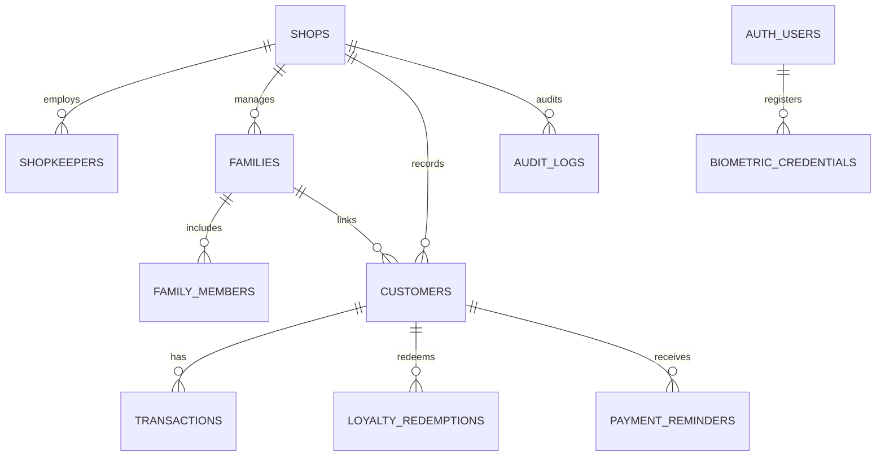
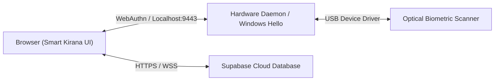

# 🛒 Smart Kirana Khata (स्मार्ट किराना खाता)
### Enterprise Digital Ledger, Shared Family Khata, Loyalty Rewards & Biometric Ready Terminal

---

## 1. Project Overview

**Smart Kirana Khata** is a production-grade, secure, animated digital ledger application engineered for Indian neighbourhood grocery (*kirana*) stores. It upgrades the traditional red bahi-khata into a modern, multi-user cloud ledger supporting:

- **Shopkeeper Admin Terminal**: Complete customer management, udhaar recording, payments collection, instant loyalty points redemption, monthly financial analytics, and CSV auditing.
- **Customer & Shared Family Portal**: Secure, read-only household access allowing all authorized family members (e.g. husband, wife, adult children) to view their shared family grocery bill, payment history, and loyalty discounts.
- **Supabase Enterprise Security**: PostgreSQL schema with Row Level Security (RLS) policies ensuring family data isolation, deterministic atomic transaction validation, and zero formula injection CSV exports.
- **Biometric & Standalone POS Ready**: Built-in support for W3C WebAuthn platform biometrics (Windows Hello, Android Fingerprint, Touch ID) and an architecture for dedicated USB optical fingerprint scanners (Mantra MFS100 / SecuGen Hamster Pro 20).

---

## 2. Technology Stack

- **Frontend**: Single-file HTML5, CSS3 (Modern Emerald Green & Warm White UI, responsive, accessible `prefers-reduced-motion` compliance), Vanilla JavaScript ES6+.
- **Authentication**: Supabase Auth (Email/Password, Mobile Identity, WebAuthn passkeys).
- **Database & Security**: Supabase PostgreSQL 15+, Row Level Security (RLS), atomic PL/pgSQL RPC functions.
- **Locale Conventions**: Indian Rupee (`₹`), Indian numbering system (`en-IN`), Asia/Kolkata timezone.
- **No AI Dependencies**: Conventional deterministic accounting logic and real database operations only.

---

## 3. Database Architecture & Schema (`schema.sql`)

The database model provides strict relational isolation between shops, shopkeepers, customers, families, and transactions.

### Entity Relationship Model

### Table Summary:
1. `public.shops` — Commercial shop profile (name, phone, address, owner).
2. `public.shopkeepers` — Authorized store clerks and managers.
3. `public.families` — Shared household khata accounts.
4. `public.family_members` — Family members authorized to view the khata.
5. `public.customers` — Customer accounts with credit limits and active flags.
6. `public.transactions` — Purchases (`purchase`) and payments (`payment`).
7. `public.loyalty_redemptions` — Atomic loyalty point redemptions.
8. `public.payment_reminders` — Account notices and payment request tracking.
9. `public.audit_logs` — Immutable audit trail of financial actions.
10. `public.biometric_credentials` — WebAuthn FIDO2 public keys.

---

## 4. Supabase Setup & Migration Guide

### Step 1: Open Supabase Project
1. Log in to your [Supabase Dashboard](https://supabase.com/dashboard).
2. Open your project (e.g. `gucdexxausukkigxvuuq`).

### Step 2: Apply Database Schema
1. Navigate to the **SQL Editor** on the left menu.
2. Click **New Query**.
3. Open `schema.sql` from this repository, copy the full contents, and paste it into the SQL Editor.
4. Click **Run** (Ctrl+Enter).
5. Verify that all tables, RLS policies, and RPC functions (`record_transaction_secure`, `redeem_loyalty_points_secure`) execute with `Success. No rows returned`.

### Step 3: Configure Authentication Settings
1. Go to **Authentication** -> **Providers** -> **Email**.
2. For testing convenience: toggle off *Confirm email* if you want immediate account activation without SMTP verification.
3. Ensure *Enable Email signup* is turned ON.

---

## 5. Verification & Testing Checklist

| # | Test Scenario | Expected Result | Verified |
|---|---|---|:---:|
| 1 | **Shopkeeper Login** | Authenticates, loads shop summary, displays customer directory | ✅ |
| 2 | **Customer Registration** | Adds customer with name, phone, credit limit; creates linked family | ✅ |
| 3 | **Udhaar Purchase Entry** | Increases customer balance; updates month purchase metric | ✅ |
| 4 | **Payment Received Entry** | Reduces balance; cannot exceed current outstanding due | ✅ |
| 5 | **Loyalty Points Calculation** | ₹100 eligible purchase = 1 point; 1 point = ₹2 discount value | ✅ |
| 6 | **Loyalty Redemption** | Deducts points & discount from balance; persists in Supabase | ✅ |
| 7 | **Prevent Double Spending** | Atomic check rejects redemption if points or balance insufficient | ✅ |
| 8 | **Family Member Login** | Detects role, shows read-only family view, hides shopkeeper tools | ✅ |
| 9 | **Data Isolation (RLS)** | Customer cannot query other families' records or insert transactions | ✅ |
| 10 | **CSV Export Security** | RFC 4180 format with BOM; formula injection prefixes neutralized | ✅ |
| 11 | **Deactivate Customer** | Soft-deletes customer from active billing list; preserves ledger | ✅ |
| 12 | **Offline Awareness** | Network listeners detect disconnection and show status banner | ✅ |

---

## 6. Standalone Shop Machine & Fingerprint Hardware Architecture

For deploying on a standalone counter machine (Mini-PC or Touch POS kiosk):

### Hardware Components:
- **Computer**: Windows 11 / Ubuntu Mini-PC (Intel N100 / Core i3, 8GB RAM, 128GB SSD).
- **Display**: 15.6" or 18.5" Touchscreen or standard monitor.
- **Biometric Sensor**: 
  - Optical USB Fingerprint Scanner: **Mantra MFS100** or **SecuGen Hamster Pro 20** or **Morpho MSO 1300 E3**.
  - Alternative: Windows Hello / FIDO2 integrated fingerprint sensor.

### Integration Plan:

1. **Option A (WebAuthn Native)**: Works directly in Chrome, Edge, and Brave using the platform authenticator (Windows Hello / Touch ID). No background service required.
2. **Option B (Dedicated USB Optical Scanner Daemon)**:
   - Run the lightweight Python daemon located in `hardware-service/kirana_fingerprint_daemon.py`.
   - Starts a local HTTPS server on `http://127.0.0.1:9443`.
   - Directs the scanner driver to capture ISO 19794-2 biometric hashes.
   - Browser client communicates with `localhost:9443` to authenticate the shopkeeper or family member without exposing biometric data to cloud storage.

---

## 7. Commercial Deployment on GitHub Pages

1. **Repository**: Push this directory to your GitHub account (`kumaransh12050-png/smart-kirana-khata`).
2. **Enable GitHub Pages**:
   - Go to your repository settings on GitHub.
   - Navigate to **Pages** -> Source: Select `Deploy from a branch` -> Branch: `main` / `root`.
   - Click **Save**.
3. Your commercial web app will be live at:
   `https://kumaransh12050-png.github.io/smart-kirana-khata/`

---

© 2026 Smart Kirana Khata. Commercial Digital Ledger System.
